# Qubenix AI — Intern Management System

A full-stack intern management system built for **Qubenix AI Pvt. Ltd.** as a Full-Stack Developer Technical Assessment. Administrators manage intern accounts, assign and track tasks, review submitted work and monitor progress from a live analytics dashboard. Interns sign in to their own workspace to start tasks, submit work and read reviewer feedback.

> Built with React + Vite + Tailwind CSS on the frontend and Node.js + Express + MongoDB (Mongoose) on the backend, with JWT authentication, bcrypt password hashing and role-based authorization on every protected endpoint.

---

## 1. Project objective

Give Qubenix AI a single internal tool to:

- Authenticate administrators and interns securely.
- Create and maintain intern profiles with linked login accounts.
- Assign tasks with priorities and deadlines.
- Track task progress from Pending → In Progress → Completed.
- Collect work submissions (description + GitHub/document links).
- Review work: approve it or request changes with feedback.
- Preserve submission and review history across resubmissions.
- Monitor the whole organisation through real database-backed analytics.

---

## 2. Assessment requirements addressed

| Requirement | Status |
| --- | --- |
| React + Vite + Tailwind frontend | Implemented |
| React Router, Axios, Lucide icons, Context API, toasts | Implemented |
| Node.js + Express REST API | Implemented |
| MongoDB Atlas + Mongoose models and references | Verified against Atlas: seeded data, transaction-backed intern creation, and persistence across an API restart |
| JWT authentication + bcrypt hashing | Implemented |
| express-validator, Helmet, CORS, Rate limiting | Implemented |
| Admin + Intern roles with server-side authorization | Implemented |
| Intern CRUD with automatic login account creation | Implemented (transactional on replica sets, compensating rollback otherwise) |
| Task CRUD, assignment, filters, overdue highlighting | Implemented |
| Submission + review workflow with resubmissions | Implemented |
| Dashboard with six real metrics + recent submissions | Implemented |
| Idempotent seed script | Implemented |
| Automated API tests | Implemented — 63 integration tests (Supertest + in-memory MongoDB) |
| README + EXPLAIN + demo instructions | Implemented |
| Application screenshots | Included — 9 genuine captures in `docs/screenshots/` |
| Video demonstration | Script and recording instructions ready (`docs/DEMO_SCRIPT.md`); recording not supplied |
| GitHub repository | Published — <https://github.com/sainath1708/Intern-Management> |
| Deployment configuration (Render + Vercel) | Configuration included; **not deployed yet** (hosting accounts/credentials pending) |
| Live deployment links | **Not available yet** — nothing has been deployed |

---

## 3. Features

### Administrator

- Secure login with role-based redirect.
- Dashboard: total interns, active interns, total tasks, completed tasks, pending tasks, in-progress tasks, overdue tasks, work awaiting review, recent submissions and recent task activity.
- Intern management: searchable/filterable/paginated table, create intern (creates the User account + Intern profile together), edit, safe delete, intern profile page with task statistics and submission history.
- Task management: create/assign/edit/delete tasks, status/priority/intern filters, task search, overdue and due-soon highlighting.
- Submission review: filter by review status, inspect work links and description, approve (task becomes Completed) or request changes (task stays In Progress, feedback required), confirmation before review actions.
- Quick actions and helpful empty states throughout.

### Intern

- Dedicated login and dashboard scoped to their own records.
- Task counts, upcoming deadlines, recent submission statuses and feedback alerts.
- Task list with status filters.
- Task detail with description, deadline, priority, status, submission history and reviewer feedback.
- Start a Pending task (moves it to In Progress).
- Submit work with a description and at least one GitHub/document URL.
- Resubmit after changes are requested.

---

## 4. Technology stack

**Frontend**

- React 18, Vite 6
- Tailwind CSS 3 (custom Qubenix design tokens)
- React Router DOM 6
- Axios with JWT request interceptor and centralized error handling
- React Context API (`AuthContext`)
- React Hot Toast
- Lucide React icons

**Backend**

- Node.js + Express 4 (ES modules)
- Mongoose 8 / MongoDB
- JSON Web Tokens (jsonwebtoken) with issuer/audience validation
- bcryptjs (pure-JavaScript bcrypt implementation — avoids native build tooling while using the same bcrypt algorithm and cost factor)
- express-validator
- Helmet, CORS, express-rate-limit, express-mongo-sanitize
- Morgan request logging

**Testing & tooling**

- Vitest + Supertest + mongodb-memory-server
- Git / GitHub-ready repository with phased commits
- Render (API) and Vercel (SPA) deployment configuration

---

## 5. Architecture

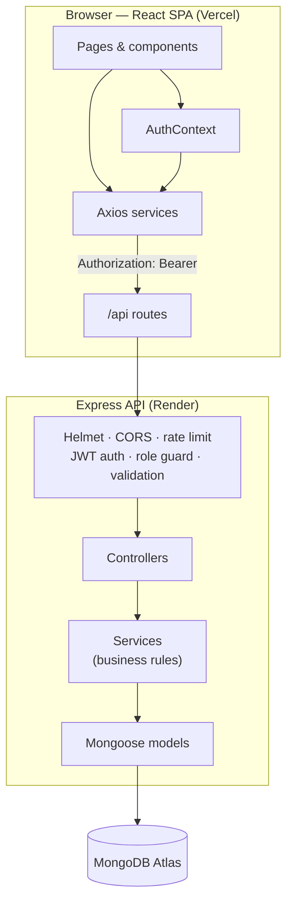

**Request lifecycle**

1. React calls a typed service in `client/src/services`.
2. Axios attaches the stored JWT and sends the request to `VITE_API_URL`.
3. Express applies security middleware, validates input and authenticates the token.
4. The route-level role guard authorizes the request.
5. The controller calls a service that enforces the business rules.
6. Mongoose persists or reads data and populates references.
7. The controller returns the standard envelope; the SPA updates its state and shows a toast.

---

## 6. Folder structure

```text
qubenix-intern-management/
├── client/
│   ├── public/                     # favicon
│   ├── src/
│   │   ├── components/
│   │   │   ├── interns/            # InternFormModal
│   │   │   ├── layout/             # BrandMark, Sidebar, Topbar
│   │   │   ├── submissions/        # SubmissionForm, ReviewModal
│   │   │   ├── tasks/              # TaskFormModal, DeadlineCell
│   │   │   └── ui/                 # Button, Input, Select, Modal, badges, ...
│   │   ├── context/AuthContext.jsx
│   │   ├── hooks/                  # useDebouncedValue, useDocumentTitle
│   │   ├── layouts/                # AuthLayout, DashboardLayout
│   │   ├── pages/
│   │   │   ├── auth/LoginPage.jsx
│   │   │   ├── admin/              # Dashboard, Interns, InternDetail, Tasks, Submissions
│   │   │   ├── intern/             # Dashboard, Tasks, TaskDetail
│   │   │   ├── ProfilePage.jsx
│   │   │   └── NotFoundPage.jsx
│   │   ├── routes/                 # AppRoutes, ProtectedRoute, RoleRoute
│   │   ├── services/               # api.js + auth/intern/task/submission/dashboard services
│   │   ├── utils/                  # constants, format, validation
│   │   ├── App.jsx
│   │   └── main.jsx
│   ├── .env.example
│   ├── package.json
│   ├── tailwind.config.js
│   ├── vite.config.js
│   └── vercel.json
├── server/
│   ├── src/
│   │   ├── config/                 # env.js, db.js
│   │   ├── controllers/            # auth, intern, task, submission, dashboard, health
│   │   ├── middleware/             # auth, validate, errorHandler, rateLimiters
│   │   ├── models/                 # User, Intern, Task, Submission
│   │   ├── routes/                 # /api router + feature routers
│   │   ├── seed/seed.js            # idempotent demo seed
│   │   ├── services/               # business logic + transaction helper
│   │   ├── utils/                  # ApiError, serializers, pagination, token, ...
│   │   ├── validators/
│   │   ├── app.js
│   │   └── server.js
│   ├── tests/                      # Vitest + Supertest integration suite
│   ├── .env.example
│   ├── package.json
│   └── vitest.config.js
├── .env.example
├── .gitignore
├── EXPLAIN.md
├── README.md
├── package.json
└── render.yaml
```

---

## 7. Database design

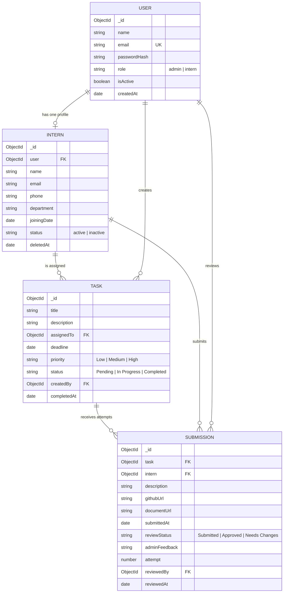

**Relationships**

- One `User` ↔ one `Intern` profile (unique `Intern.user`).
- One `Intern` → many `Task`s (`Task.assignedTo`).
- One admin `User` → many `Task`s (`Task.createdBy`).
- One `Task` → many `Submission` attempts (resubmission history).
- Each `Submission` belongs to the task and the intern who submitted it.

**Indexes**

- `User.email` unique; `User.role`.
- `Intern.user` unique; `name`, `email`, `department + status`, `deletedAt`.
- `Task`: `assignedTo + status`, `status + priority`, `deadline`, `createdAt`.
- `Submission`: `task + submittedAt`, `intern + reviewStatus`, `reviewStatus + submittedAt`.

---

## 8. Authentication and authorization

- `POST /api/auth/login` validates credentials with bcrypt and returns a signed JWT (`sub`, `role`, 1 day expiry by default, issuer + audience claims).
- The SPA stores the token in `localStorage` under `qubenix_token` and sends it as `Authorization: Bearer <token>`.
- `authenticate` verifies the signature, expiry, issuer and audience, loads the user from MongoDB, rejects deactivated accounts and attaches the intern profile when relevant.
- `authorize('admin')` / `authorize('intern')` enforce role access on the server. Frontend route guards are a UX layer only.
- Resource-level checks: interns can only read/update their own tasks, only submit to their own tasks, and can only move Pending → In Progress. Completion happens exclusively through admin approval.
- Password hashes are `select: false` in Mongoose, removed in serializers and never returned by any endpoint.

---

## 9. API endpoints

Base URL: `/api`. All responses use:

```json
{ "success": true, "message": "Operation completed successfully", "data": {} }
```

Errors:

```json
{ "success": false, "message": "Human-readable message", "errors": [] }
```

| Method | Endpoint | Access | Description |
| --- | --- | --- | --- |
| GET | `/health` | Public | API + MongoDB connection status |
| POST | `/auth/login` | Public (rate limited) | Email/password login, returns JWT |
| GET | `/auth/me` | Authenticated | Current user (+ intern profile) |
| GET | `/interns` | Admin | List interns — `search`, `department`, `status`, `page`, `limit` |
| POST | `/interns` | Admin | Create User + Intern atomically |
| GET | `/interns/:id` | Admin | Intern profile, task stats, recent tasks/submissions |
| PUT | `/interns/:id` | Admin | Update intern and linked account |
| DELETE | `/interns/:id` | Admin | Delete (no history) or archive (with history) |
| GET | `/tasks` | Admin / Intern | Admin: all tasks. Intern: own tasks only. Filters: `status`, `priority`, `internId`, `search`, `page`, `limit` |
| GET | `/tasks/:id` | Admin / Intern (own) | Task + submission history |
| POST | `/tasks` | Admin | Create and assign a task |
| PUT | `/tasks/:id` | Admin | Update task (blocks reassignment once submissions exist) |
| DELETE | `/tasks/:id` | Admin | Delete task and its submissions |
| PATCH | `/tasks/:id/status` | Intern (assigned) | Pending → In Progress only |
| POST | `/tasks/:id/submissions` | Intern (assigned) | Submit work (description + ≥1 link) |
| GET | `/submissions` | Admin | All submissions — `reviewStatus`, `internId`, `taskId`, `search`, pagination, summary counts |
| PATCH | `/submissions/:id/review` | Admin | Approve or request changes (feedback required) |
| GET | `/dashboard/stats` | Authenticated | Admin metrics or intern-scoped summary |

**Role rules enforced in services, not just routes**

- Interns cannot list interns, create/edit/delete tasks, review submissions or see other interns' data.
- Interns cannot mark tasks Completed directly.
- Submissions are rejected for completed tasks and while a previous attempt awaits review.
- Approving sets the task to Completed; requesting changes keeps it In Progress and requires ≥10 characters of feedback.
- Reassignment of a task with submission history is blocked to keep review history coherent.
- Deleting an intern with history archives them (`deletedAt`, status `inactive`, account deactivated) instead of destroying records.

---

## 10. Local installation

**Prerequisites:** Node.js ≥ 18.18, npm, a MongoDB Atlas cluster (or MongoDB running locally).

```bash
git clone https://github.com/sainath1708/Intern-Management.git
cd Intern-Management

# install root tooling (concurrently), server and client dependencies
npm install
npm run install:all
```

Create the environment files:

```bash
cp server/.env.example server/.env
cp client/.env.example client/.env
```

Edit `server/.env` with your MongoDB Atlas URI and a strong `JWT_SECRET` (32+ characters).

Run both applications:

```bash
npm run dev          # API on :5000 and Vite on :5173
# or separately
npm run dev:server
npm run dev:client
```

Open <http://localhost:5173>.

### Local demo database fallback

If you have not created an Atlas cluster yet, set:

```env
USE_IN_MEMORY_DB=true
```

The API then starts a temporary in-memory MongoDB (via `mongodb-memory-server`), seeds demo data automatically and is immediately usable. **Data is lost on restart and this option is blocked when `NODE_ENV=production`.** For real persistence use MongoDB Atlas.

---

## 11. Environment configuration

### `server/.env`

| Variable | Required | Purpose |
| --- | --- | --- |
| `NODE_ENV` | Yes | `development` / `production` / `test` |
| `PORT` | No (5000) | API port |
| `MONGODB_URI` | Yes (unless in-memory demo) | MongoDB Atlas connection string |
| `USE_IN_MEMORY_DB` | No | `true` starts a temporary local demo database |
| `JWT_SECRET` | Yes in production | 32+ character signing secret |
| `JWT_EXPIRES_IN` | No (1d) | Token lifetime |
| `FRONTEND_URL` | Yes | Allowed browser origins, comma separated |
| `ADMIN_NAME`, `ADMIN_EMAIL`, `ADMIN_PASSWORD` | Seed only | Primary administrator created by the seed |
| `SEED_INTERN_PASSWORD` | No | Demo intern password (defaults to `Intern@12345`) |
| `TRUST_PROXY` | No (1) | Reverse proxy hops; accepts `true` or a number (Render = 1) |
| `DNS_SERVERS` | No | Comma-separated resolvers (e.g. `8.8.8.8,1.1.1.1`) for networks whose default resolver refuses Atlas SRV lookups. Leave unset on Render. |

Environment validation runs at startup. Production starts fail fast if the Mongo URI or JWT secret is missing/too short.

### `client/.env`

| Variable | Purpose |
| --- | --- |
| `VITE_API_URL` | API base URL including `/api`, e.g. `http://localhost:5000/api` |
| `VITE_DEMO_ADMIN_EMAIL` / `VITE_DEMO_ADMIN_PASSWORD` | Optional local-only shortcut buttons on the login page. Leave blank in production. |
| `VITE_DEMO_INTERN_EMAIL` / `VITE_DEMO_INTERN_PASSWORD` | Optional local-only intern shortcut. Leave blank in production. |

The demo shortcuts only render when both the email and password variables are present. Production builds must leave them blank so no credentials are bundled into the JavaScript. |

`server/.env` and `client/.env` are git-ignored; only the `.example` files are committed. No real secrets exist in this repository.

---

## 12. MongoDB Atlas setup

1. Create a free cluster at <https://cloud.mongodb.com>.
2. **Database Access** → add a user with password authentication (least privilege).
3. **Network Access** → add your current IP. For Render, allow Render's egress IPs (or `0.0.0.0/0` for a demo — restrict this in production).
4. Copy the connection string and append a database name:
   ```text
   mongodb+srv://<user>:<password>@<cluster>.mongodb.net/qubenix?retryWrites=true&w=majority
   ```
5. Put it in `server/.env` as `MONGODB_URI`, set `USE_IN_MEMORY_DB=false`, and append a database name (for example `/qubenix_intern_management`) before the query string.
6. Start the API and confirm `GET /api/health` reports `"database": { "connected": true }`.

If Node reports `querySrv ECONNREFUSED` while Windows can resolve the cluster, the local resolver is refusing SRV lookups from Node. Add `DNS_SERVERS=8.8.8.8,1.1.1.1` to `server/.env`; the API applies it before connecting. Leave it unset on Render.

Atlas clusters are replica sets, so the User + Intern creation uses a real multi-document transaction there.

---

## 13. Seed data

```bash
npm run seed --prefix server
# or from the root
npm run seed
```

Requires `MONGODB_URI`, `ADMIN_NAME`, `ADMIN_EMAIL`, `ADMIN_PASSWORD` in `server/.env`.

The script is **idempotent**:

- Creates exactly one administrator if it does not exist.
- Creates three sample interns with linked accounts.
- Creates six sample tasks covering Pending / In Progress / Completed, Low / Medium / High priorities, multiple interns, overdue and upcoming deadlines.
- Creates three sample submissions (two Approved, one awaiting review) to populate the review queue.
- Skips existing records and never overwrites an existing password. Existing users are reported as skipped.

When running with `USE_IN_MEMORY_DB=true`, the API runs the same seed automatically on startup.

### Demo credentials (development/demo only)

| Role | Email | Password |
| --- | --- | --- |
| Admin | `admin@qubenix.ai` | `Admin@12345` |
| Intern | `aarav.sharma@qubenix.ai` | `Intern@12345` |
| Intern | `diya.patel@qubenix.ai` | `Intern@12345` |
| Intern | `rohan.iyer@qubenix.ai` | `Intern@12345` |

These values come from `.env.example` and are intended only for the seeded demo. Change them before any real deployment.

---

## 14. Running the application

| Command | Description |
| --- | --- |
| `npm run dev` | API + client together (concurrently) |
| `npm run dev:server` | Express API with nodemon |
| `npm run dev:client` | Vite dev server |
| `npm run build` | Production frontend build |
| `npm start` | Start the API (production mode) |
| `npm test` | Run the backend integration suite |
| `npm run seed` | Seed demo data |

API health check: `curl http://localhost:5000/api/health`.

---

## 15. Testing

```bash
npm test              # from the repository root
# or
npm run test --prefix server
```

The suite uses Vitest + Supertest and starts an isolated in-memory MongoDB per test file. It does not touch your Atlas data.

**Current result: 63/63 tests passing across 5 suites.**

Coverage includes:

- **Auth (15):** admin/intern login, invalid credentials, missing/invalid/expired/forged tokens, role restriction, deactivated account, password hashes never exposed, login rate limiting, health endpoint.
- **Interns (14):** pagination, search, filters, create (account + profile), bcrypt storage, duplicate email, validation failures, profile stats, update + email sync, delete without history, archive with history, intern blocked from admin routes.
- **Tasks (13):** create/assign, past deadline, invalid/inactive intern, filters/search/pagination, intern scoping, role restrictions, Pending → In Progress, blocked Completed transition, admin update, reassignment guard, cascade delete.
- **Submissions (16):** valid submission, missing/invalid links, unauthorized intern, correct relationships, task stays In Progress, duplicate awaiting review, admin list/summary/search, feedback required, Needs Changes flow, resubmission + history, approval completes task, blocked submissions after completion, double approval.
- **Dashboard (5):** exact six metric counts, pending review/overdue counts, recent submissions, recent tasks, intern scoping, authentication requirement.

Frontend production build (`npm run build`) succeeds. Manual browser checks verified login, role redirects, dashboard (3 interns, 6 tasks: 2 completed / 2 pending / 2 in progress), intern list, task list, submission list and review modal rendering; API behavior for the full workflow is covered by the automated suite above. The same checks are documented visually in `docs/screenshots/` (see section 18).

---

## 16. Deployment

Nothing has been deployed from this workspace. The configuration and steps below are ready to use.

### Backend → Render

1. Push the repository to GitHub.
2. In Render: **New → Blueprint** and select the repository (uses `render.yaml`), or create a Web Service manually:
   - Root directory: `server`
   - Build command: `npm install`
   - Start command: `npm start`
   - Health check path: `/api/health`
3. Configure environment variables in the Render dashboard. `render.yaml` already supplies `NODE_ENV`, `JWT_EXPIRES_IN` and `TRUST_PROXY`; add the secret values yourself:
   - `MONGODB_URI=<Atlas URI>`
   - `JWT_SECRET=<32+ char secret>`
   - `FRONTEND_URL=https://<your-vercel-app>.vercel.app` (comma separated for several origins)
   - `ADMIN_NAME`, `ADMIN_EMAIL`, `ADMIN_PASSWORD`
   - `SEED_INTERN_PASSWORD` (optional; defaults to `Intern@12345`)
4. Deploy, then open a Render shell and run `npm run seed` once.
5. Verify `https://<service>.onrender.com/api/health` returns 200 with `"database": { "connected": true }`.
6. Sign in once with the admin account and once with an intern account to confirm Atlas persistence.

`TRUST_PROXY=true` and `TRUST_PROXY=1` are both accepted; the API normalises either form to one trusted proxy hop.

### Frontend → Vercel

1. Import the repository in Vercel.
2. Set **Root Directory** to `client` (the included `client/vercel.json` handles the Vite build and SPA routing).
3. Environment variable: `VITE_API_URL=https://<render-service>.onrender.com/api`.
4. Leave `VITE_DEMO_ADMIN_EMAIL`, `VITE_DEMO_ADMIN_PASSWORD`, `VITE_DEMO_INTERN_EMAIL` and `VITE_DEMO_INTERN_PASSWORD` unset in production.
5. Deploy. The rewrite sends every non-file route to `index.html`, so refreshing `/admin/tasks` or `/intern/tasks/:id` works.
6. Update the Render `FRONTEND_URL` to the Vercel production URL and redeploy the API so CORS allows it.
7. Confirm the browser console has no CORS errors and both roles can sign in.

### Production checklist

- [ ] Atlas cluster reachable from Render, database user created.
- [ ] Strong `JWT_SECRET`, demo passwords replaced.
- [ ] `FRONTEND_URL` exactly matches the deployed SPA origin (no trailing slash).
- [ ] Seed executed once on production.
- [ ] Login works for both roles over HTTPS.
- [ ] Health endpoint reports a connected database.

---

## 17. GitHub repository

**Repository:** <https://github.com/sainath1708/Intern-Management>

- Default branch: `master`
- The original implementation history was pushed unchanged; later documentation and configuration commits are on the same `master` branch.
- `.env` files, database URIs, JWT secrets and passwords are git-ignored and are not part of the repository.

To work from a clone:

```bash
git clone https://github.com/sainath1708/Intern-Management.git
cd Intern-Management
```

---

## 18. Application screenshots

These are genuine captures from the running application (seeded demo data, local API + Vite client), stored in [`docs/screenshots/`](docs/screenshots/).

### Login

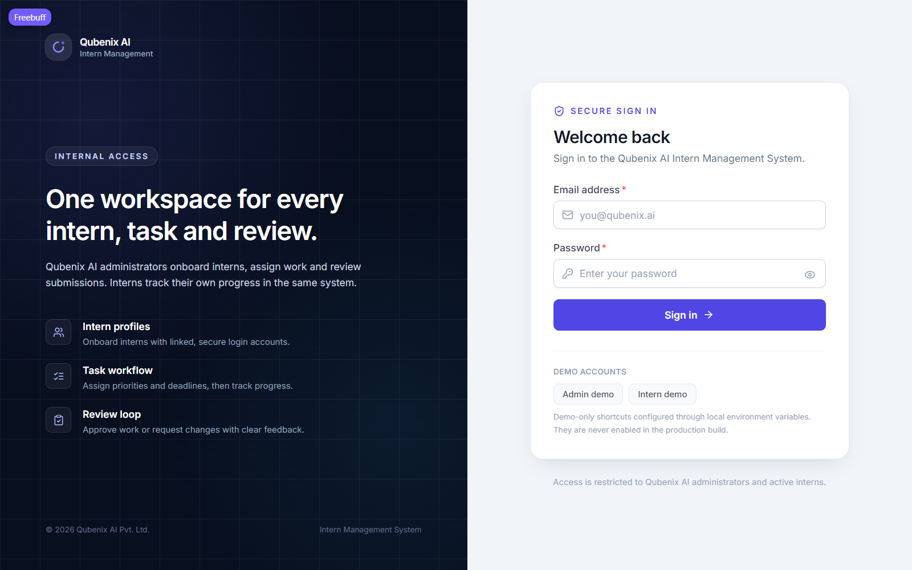

### Admin workspace

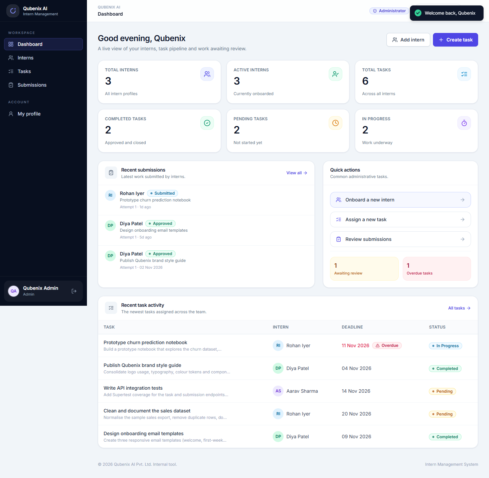

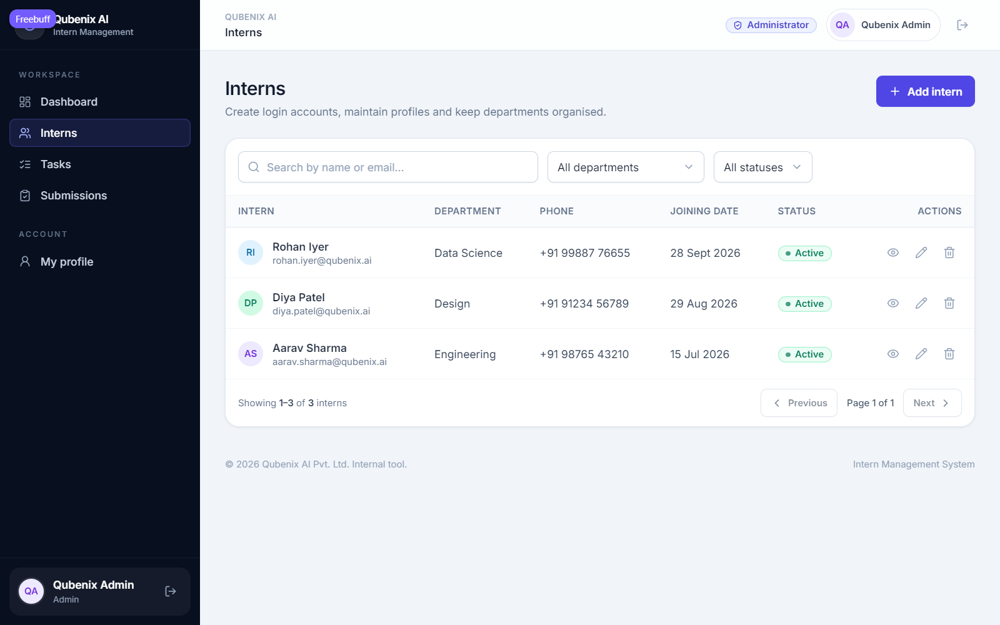

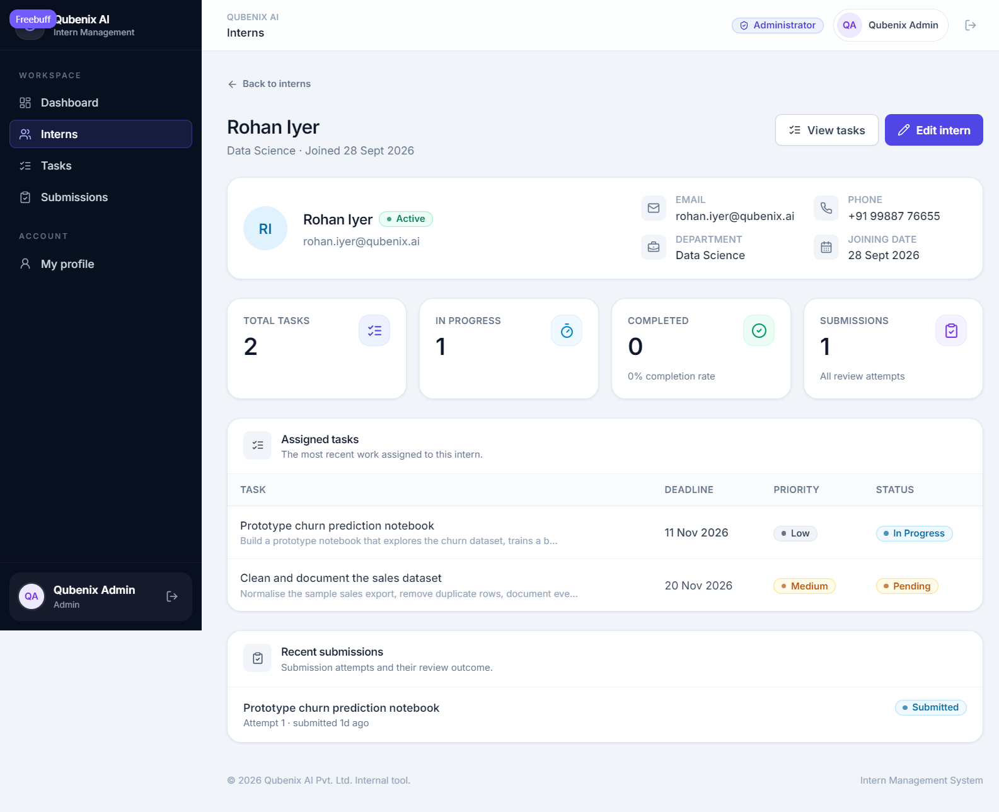

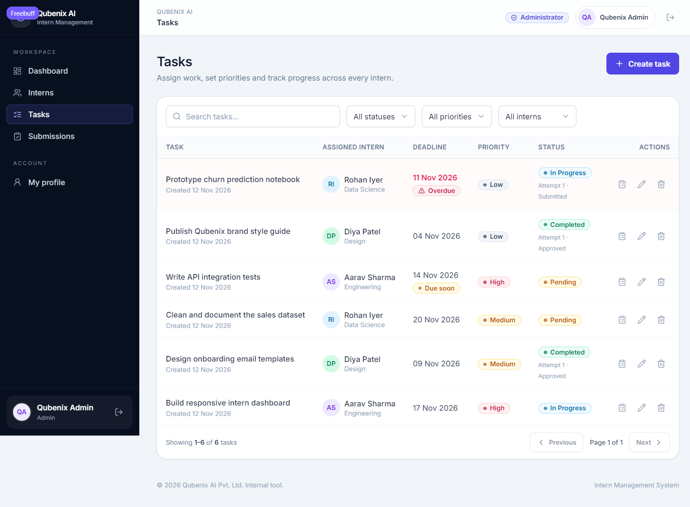

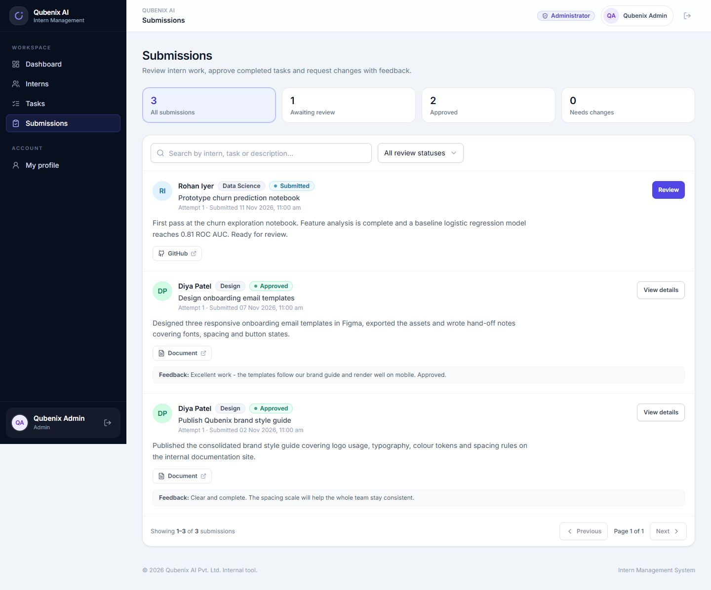

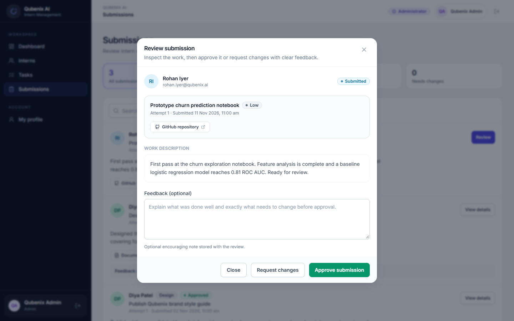

### Intern workspace

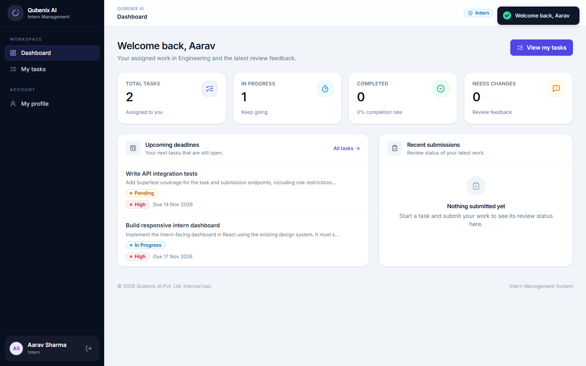

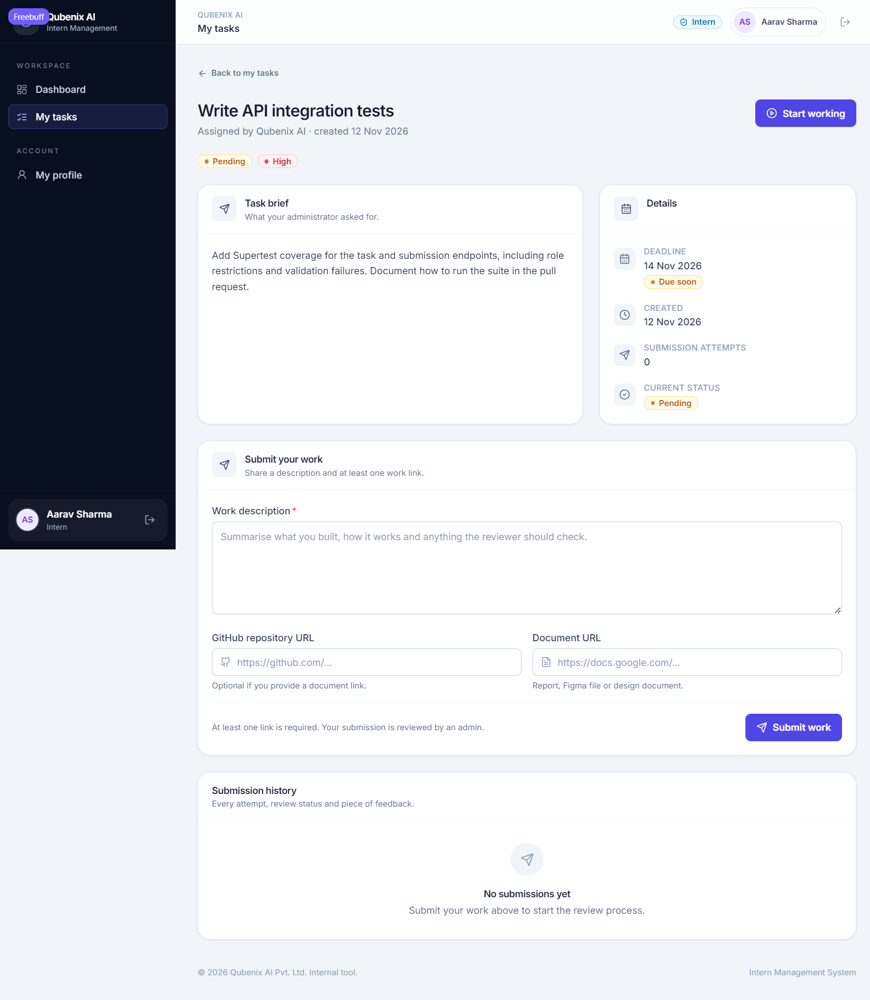

To reproduce them, start the app with the local in-memory demo database, sign in with the demo accounts from section 13 and follow the same pages.

---

## 19. Video demonstration plan (3–5 minutes)

The full shot-by-shot narration, exact clicks and recording instructions are in [`docs/DEMO_SCRIPT.md`](docs/DEMO_SCRIPT.md). Summary:

1. **Introduction (20s):** project name, stack, roles.
2. **Admin login (15s):** sign in, land on the dashboard.
3. **Dashboard (30s):** point out the six required metrics and recent submissions.
4. **Create an intern (40s):** open the modal, fill the form, show the new login account in the table.
5. **Create and assign a task (40s):** choose intern, deadline, priority; show it appears as Pending.
6. **Intern login (20s):** sign out, sign in with the demo intern.
7. **Task progress (30s):** open the task, move it to In Progress.
8. **Submit work (40s):** description + GitHub link, show the awaiting-review state.
9. **Admin review (45s):** submissions page, open the attempt, request changes with feedback (or approve).
10. **Feedback loop (35s):** sign back in as the intern, show the feedback and resubmit.
11. **Approve and wrap up (25s):** approve as admin, show the task Completed and the dashboard totals updating.

Record with any screen recorder (OBS, Loom, Windows Game Bar). Show real interactions only; no mockups.

---

## 20. Design decisions and trade-offs

- **Service layer:** controllers stay thin; business rules live in services so they can be unit-tested and reused, and role rules are never only in route middleware.
- **DTO serializers:** every response passes through explicit serializers. This keeps API shapes stable, strips `passwordHash`, and prevents accidental field leakage.
- **Transactions with a fallback:** User + Intern creation uses a MongoDB transaction. Atlas replica sets support it; a standalone local MongoDB cannot, so the service detects that specific limitation and compensates by deleting the created user if profile creation fails. This keeps the invariant on every deployment type.
- **Safe deletion:** interns with history are archived, not deleted. This preserves tasks and review history, which is more important for an auditable internal tool than hard deletion.
- **Review integrity:** task reassignment is blocked once submissions exist, duplicate submissions are blocked while one is pending review, and approved submissions cannot be re-reviewed. These rules prevent incoherent history.
- **LocalStorage JWT:** simple and appropriate for this assessment. Trade-off: it is readable by JavaScript, so a production system handling sensitive data should prefer httpOnly cookies with refresh-token rotation and CSRF protection.
- **In-memory demo DB fallback:** lets the project run end-to-end without Atlas credentials. It is explicitly disabled in production and documented as non-persistent.

---

## 21. Known limitations

- The source is published on GitHub, but Render/Vercel deployment has not been completed yet, so public application URLs are not available.
- Local development also supports the documented in-memory fallback. MongoDB Atlas is configured, seeded and verified, including persistence across a restart and transaction-backed intern creation.
- No password reset / change-password flow (not part of the assessment scope). Admins cannot reset an intern password after creation.
- No file uploads; submissions accept URLs to GitHub/documents, not hosted files.
- No email notifications; feedback is delivered in-app.
- Access tokens are stored in `localStorage` and last 1 day; no refresh tokens or server-side revocation list.
- Rate limiting is in-memory per API instance (fine for one Render instance; use a shared store when scaling horizontally).
- `bcryptjs` is used instead of the native `bcrypt` package to avoid platform build tooling; both produce standard bcrypt hashes.
- No CI pipeline is configured.
- Screenshots are included, but no recorded video is bundled: `docs/DEMO_SCRIPT.md` provides the exact narration, sequence and recording instructions for the assessor.
- Dashboard analytics are computed with count queries on each request; acceptable at intern-team scale, would be cached/aggregated at larger volume.

---

## 22. License / usage

Created for the Qubenix AI Full-Stack Developer Technical Assessment. Internal demonstration project.
